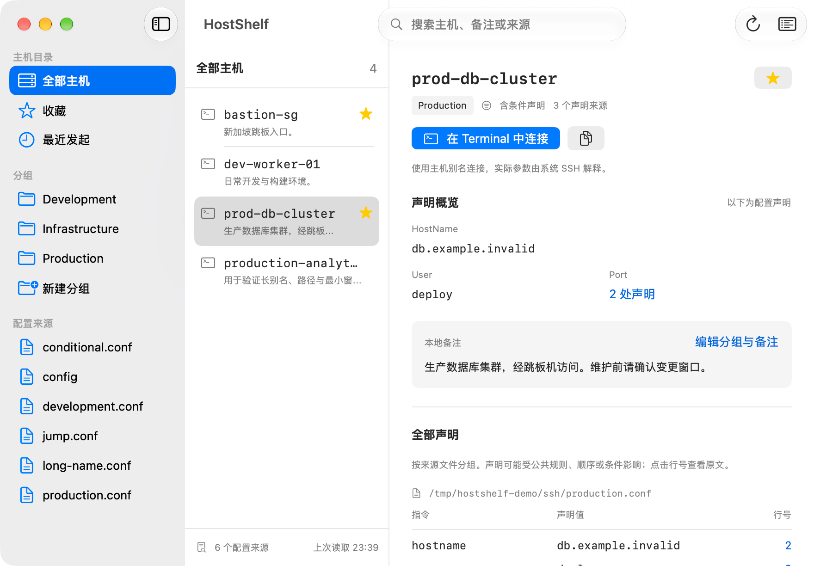

# HostShelf

macOS SSH 主机目录与终端启动器。采用 SwiftUI、系统框架和 XcodeGen；Core 同时提供 SwiftPM 测试入口。SSH 配置只读，分组、收藏和备注保存在应用自己的数据目录。

GitHub 仓库：[maydaychen/hostshelf](https://github.com/maydaychen/hostshelf)。



深色界面见 [预览截图](docs/images/hostshelf-dark.png)。验证范围与发行状态见 [验收记录](docs/acceptance.md)。

## 安装

从 [v0.1.3 Release](https://github.com/maydaychen/hostshelf/releases/tag/v0.1.3) 下载：

- Apple Silicon Mac（M 系列）：`HostShelf-0.1.3-macos-arm64.dmg`。
- Intel Mac：`HostShelf-0.1.3-macos-x86_64.dmg`。

打开对应 DMG，将 HostShelf 拖到 Applications。最低要求 macOS 14；两种架构的 App 与 DMG 均使用 Developer ID 签名，并已通过 Apple 公证及装订票据。Release 保留预发布标记，发布说明包含每份安装包的 SHA-256；此前下载的未公证包需重新下载。

## 开发

需要 Xcode、命令行工具及 XcodeGen。最低部署目标为 macOS 14。

```sh
./script/test.sh
./script/test_manual_refresh.sh
./script/test_terminal_launcher.sh
./script/test_app_interactions.sh
./script/build.sh arm64
./script/build.sh x86_64
./script/build_and_run.sh --verify
./script/check_readonly.sh
```

`project.yml` 是版本与工程设置的事实源。运行脚本提供 `--debug`、`--logs`、`--telemetry` 和 `--verify`，Codex Run 使用同一个入口。

应用图标原图和完整尺寸资源均在仓库内；重新生成使用 `./script/generate_app_icon.sh`，详见 [图标源文件说明](Design/README.md)。

编译缓存与磁盘映像工具的暂存数据位于系统临时目录下本项目专属的 `HostShelf-tools-*`，避免 File Provider 给测试包附加 FinderInfo 导致签名失败；测试日志和任务证据放在项目 `.tmp/`，最终安装包在 `dist/`。`check_readonly.sh` 只盘点配置、比较内容摘要，不执行 SSH 或配置中的命令；输出统计，不输出主机地址或别名。

统一验证使用 `python3 scripts/harness/verify.py --mode task` 或 `--mode release`。当前采用手动验证入口，未安装 Git Hooks。

Release 构建会映射本机源码／构建目录并剥离调试路径，签名前和产物复验时再检查整个 App；检出个人路径或调试映射即失败。检查命令及 Git 历史清理边界见 [隐私与发行检查](docs/privacy.md)。

## 使用

应用从用户和系统 SSH 配置入口读取 Host 和 Include，侧栏“配置来源”只列出包含主机的配置文件，全部已扫描来源（含仅含全局规则或未能读取的文件）可在“配置诊断与规则”中查看。列表展示配置声明，条件规则不代表一定生效。收藏、分组和备注不写回 SSH 配置。点击连接后由所选终端在新窗口运行所选别名；首次连接需允许自动化，拒绝后可复制命令或在系统设置中调整权限。

在“HostShelf → 设置…”中可配置“登录时自动启动 HostShelf”、全局快速启动浮窗快捷键（默认未绑定，支持按键录制与一键启用 `⌃⌥H`）、默认终端（Terminal、iTerm2 或 Ghostty，默认使用 Terminal）及默认外部编辑器（VS Code、Cursor、Zed 或系统默认编辑器）。选择立即保存在本机偏好设置中，主窗口按钮和菜单栏等所有连接入口共用该设置。未安装的选项灰显；所选终端被移除时会提示原因，不自动切换到其他终端。Ghostty 需要 1.3.0 或更新版本，并启用其 [AppleScript 支持](https://ghostty.org/docs/features/applescript)。

启动时首次读取配置，之后仅在主动点击刷新按钮、刷新菜单或按 `⌘R` 时重新读取。修改配置或切回应用不会自动刷新。刷新按钮保持原位，耗时超过 250 毫秒才显示进度，减少短暂扫描的闪烁。

在主窗口中间列表单击主机名或行空白可选择主机并查看详情；双击主机可交给默认终端连接。方向键可以切换列表选择，右键菜单及详情页“更多操作”支持单次切换其他终端连接、使用 VS Code／Cursor／Zed Remote-SSH 打开、复制 `HostName`／`User@HostName`／`scp` 模板，以及在外部编辑器中直接打开对应配置文件及行号。

快速启动浮窗可通过菜单栏、“主机 → 快速启动浮窗…”或已设置的全局快捷键随时呼出，支持别名、备注、地址与分组的模糊匹配；列表中 `Return` 直接连接、`⌥Return` 在主窗口定位、`⌘C` 复制命令、`Esc` 关闭。

详情先显示地址、用户与端口的声明概览；多处声明显示数量，未声明项交由 SSH 判断。列表中的地址只有一个声明值时直接显示，多值显示“多处地址声明”。完整声明按来源文件分组，点击行号可展开原文、定位并高亮，指令列随内容在合理范围内适配，并可从来源片段按钮或行号右键菜单直接用外部编辑器打开跳转。

备注默认阅读，点击“编辑分组与备注”展开编辑。停止输入约 400 毫秒后自动保存；点击“完成”、切换主机、关闭窗口和正常退出时保存待处理草稿。保存失败会提示并在本次运行期间保留草稿；退出前仍无法保存时，可返回应用，或明确选择放弃草稿并退出。分组右键菜单支持删除空分组，仍被保留记录或草稿使用的分组不能删除。

使用 `⌘F` 聚焦搜索并全选已有查询，可直接输入替换文字；搜索支持模糊子序列及多关键字匹配并高亮匹配文字，点击清除按钮后保持输入焦点，在搜索框按 Esc 则清空并移出焦点。侧栏“最近发起”按成功交接时间倒序显示主机。搜索命令也可从设置窗口返回主窗口，或恢复最小化、已关闭的主窗口。

连接交接在串行后台执行，期间显示忙碌状态并禁用重复提交；成功交接和复制命令使用短暂状态，错误单独提示。关闭主窗口期间发生的错误可从菜单栏“查看连接或复制错误…”恢复查看。交接成功只表示已交给终端，不表示 SSH 登录成功。没有匹配文件的 Include 作为提示列出，实际读取或解析失败仍列为警告。

顶部右侧 HostShelf 图标及应用“主机”菜单提供“全部主机”二级菜单，按别名自然排序显示完整索引，点击后直接交给默认终端连接。菜单不受主窗口搜索或分组筛选影响；长别名保留头尾并提供完整提示。右侧入口同时保留收藏和最近发起快捷项。

关闭窗口后菜单栏保持运行；退出应用请使用退出菜单。数据位于 `~/Library/Application Support/HostShelf/`。应用不读取 IdentityFile 的内容，不运行后台连通性探测，不上传配置。

Debug 构建可使用 `open --env HOSTSHELF_CONFIG_ROOTS=<配置绝对路径> --env HOSTSHELF_METADATA_PATH=<隔离元数据绝对路径> <HostShelf.app>` 载入隔离样本；多个配置入口用冒号分隔。`HOSTSHELF_UI_APPEARANCE=light` 或 `dark` 仅改变该应用外观。Release 构建忽略上述环境变量。

## 分架构打包

```sh
./script/package.sh --preview
```

本地试用包保存在 `dist/local-preview/`，仅临时签名、未经公证，不能作为正式发行包。ARM 与 Intel 包分别命名为 `HostShelf-<version>-macos-arm64.dmg` 和 `HostShelf-<version>-macos-x86_64.dmg`，两者是同一应用的替代包。

已有 Developer ID 身份时，可设置 `HOSTSHELF_SIGN_IDENTITY` 后执行 `./script/package.sh --developer-id`，生成 `dist/signed-preview/` 下的签名试用候选。该模式完成 Developer ID 签名和安全时间戳，不上传 Apple 公证，不能当作已公证的正式发行版。

对实际安装包进行只读挂载、架构、权限、签名和 SHA 校验使用 `./script/verify_packages.sh --developer-id`。公证发行包改用 `--signed`，临时签名包改用 `--preview`；检查不会安装或启动应用。

获发行授权、准备 Developer ID 身份和 Keychain 中的 notarytool profile 后，可通过环境变量 `HOSTSHELF_SIGN_IDENTITY`、`HOSTSHELF_NOTARY_PROFILE` 调用 `./script/package.sh --signed`。该模式会上传 Apple 公证，输出位于 `dist/release/`；不得在未获对应授权时执行。每次打包使用独立暂存目录，脚本拒绝覆盖既有安装包。

进度与验收见 [ROADMAP.md](ROADMAP.md)，实施边界见 [施工清单](goals/20261023-2210-hostshelf-v1.md)。
